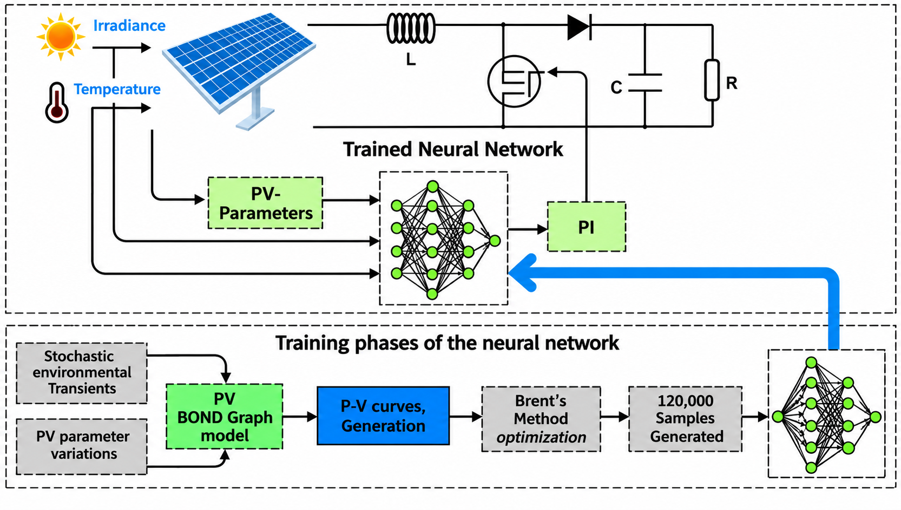
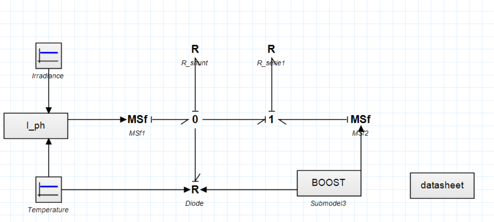
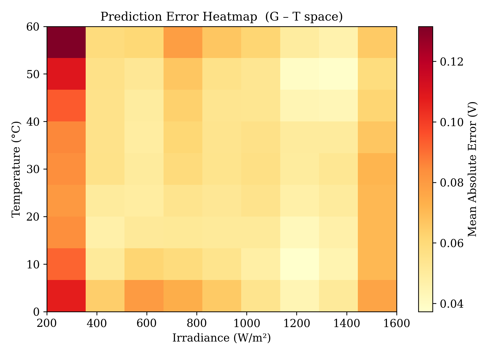
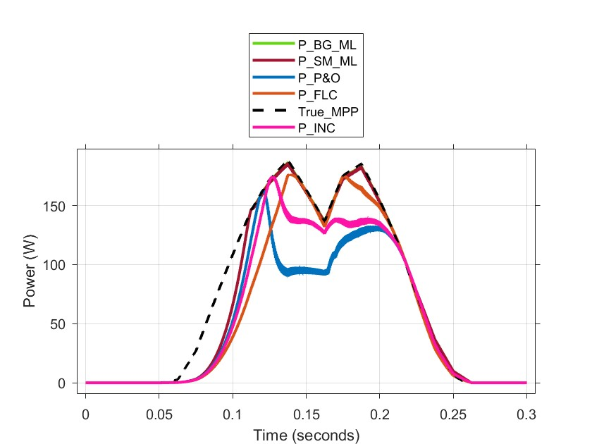

# Bond Graph-Driven Machine Learning MPPT for Photovoltaic Systems

**A multi-module parametric framework with a model-based reference from Brent's optimization**

Abdelhak Samir Douli, Abd Essalam Badoud, Belkacem Ould Bouamama, Mahdi Boukerdja
*LAS, Université Sétif 1 (Algeria) · CRIStAL UMR 9189, Université de Lille (France)*

📄 Accepted in **Energies (MDPI)**, 2026 · DOI coming soon <!-- TODO: add DOI link once online -->

---



## Problem

Most ML-based MPPT controllers are trained on **one** PV module and must be retrained for every new panel.
They are also usually trained on targets produced by another tracking algorithm, so they inherit its errors.

## Approach

1. **Parametric bond graph model** of the PV module (built in 20-sim), so that the module itself becomes an input.
2. **2,187 virtual modules.** Seven parameters (Ns, Rs, Rsh, n, I₀, α_Isc, β_Voc) are swept over 3 levels each, with irradiance from 200 to 1600 W/m² and temperature from 0 to 60 °C.
3. **Exact training targets.** For every curve, the MPP voltage is computed with **Brent's method**, so the labels don't depend on any tracking algorithm.
4. **Compact neural network.** 9 inputs → 32 → 16 → 1, with batch normalization and dropout. It predicts V_MPP, which is enforced through a boost converter.

<p align="center"> </p>
<p align="center"><em>Left: bond graph model of the PV panel in 20-sim. Right: mean V_MPP prediction error over the irradiance–temperature space.</em></p>

## Evaluation

The proposed **BG-ML** controller is compared with P&O, INC, a fuzzy logic controller (FLC), and an **identical network trained on a single module (SM-ML)**.
All controllers were tuned once on a reference module, then applied **unchanged to four commercial modules never seen in training**.
Three scenarios were tested: temperature ramps, irradiance ramps, and a daily-shaped irradiance profile with NOCT-based cell temperature.

| Scenario | BG-ML tracking efficiency | Benchmarks (P&O / INC / FLC) |
|---|---|---|
| Temperature ramp (25 → 45 → 25 °C) | **98.2 – 99.9 %** | 90.2 – 99.3 % |
| Irradiance ramp (1000 → 600 → 1000 W/m²) | **99.3 – 99.9 %** | 71.4 – 93.5 % (P&O, INC) |
| Combined irradiance + temperature | **96.9 – 99.7 %** | 56.3 – 93.4 % |

* The BG-ML reaches the MPP in **17 – 37 ms**.
* The SM-ML matches BG-ML on modules similar to its training module, but **drops to 87 – 89 %** on the most different one. This shows that the robustness comes from the multi-module training.
* Under sensor noise, sensor bias and thermal delay, the mean power loss stays **below 0.45 %**.


*Combined scenario on the Advance Power API-P210 module: BG-ML (green) stays on the true MPP (dashed), while P&O and INC lose it at the peaks.*

## Limitations (as stated in the paper)

* Results come from simulation on compressed time scales, with uniform irradiance.
* The reference MPP is exact for the single-diode model, but it is not a physical ground truth.
* Hardware-in-the-loop and experimental validation are the next steps.

## Related work

* [pv-ml-mppt](https://github.com/abdelhaksamirdouli/pv-ml-mppt): the first version of this framework, published in *Results in Engineering* (2025).

## Tools

MATLAB/Simulink · 20-sim (bond graph) · Python · PyTorch · SciPy (Brent's method)

## Code

The simulation models and training code are kept in a private repository during the PhD. They are **available on request**: douli.a@univ-setif.dz.

## Citation

```bibtex
@article{douli_bgmlmppt,
  author  = {Douli, Abdelhak Samir and Badoud, Abd Essalam and Ould Bouamama, Belkacem and Boukerdja, Mahdi},
  title   = {Bond Graph-Driven Machine Learning MPPT for Photovoltaic Systems: A Multi-Module Parametric Framework with a Model-Based Reference from Brent's Optimization},
  journal = {Energies},
  note    = {Accepted; volume, pages and DOI to be added}
}
```

## Funding

This work is part of a joint PhD (cotutelle) between Université Sétif 1 and Université de Lille. It is supported by the PHC Tassili project No. 51327SE, *Integrated Design of Resilient Systems for Green Hydrogen Production*.
